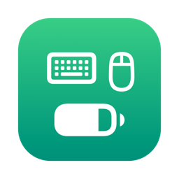
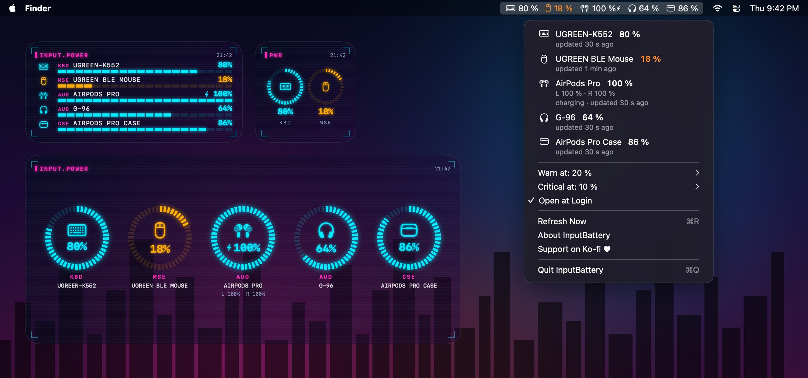
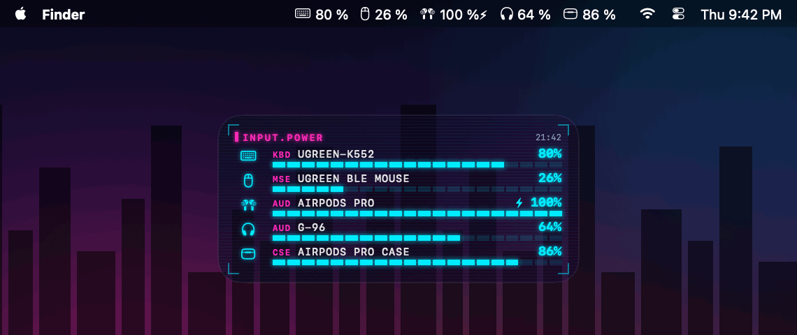
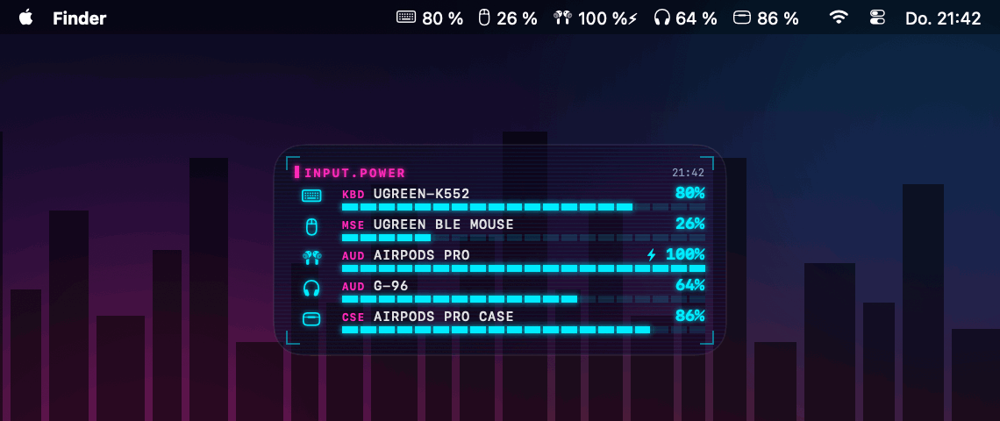
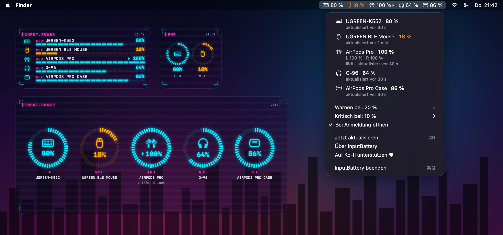

<p align="center">
  
</p>

<h1 align="center">InputBattery</h1>

<p align="center">
  Battery levels of your Bluetooth keyboard, mouse, headset and AirPods –<br>
  in the menu bar, as a neon desktop widget, with a warning before they run empty.
</p>

<p align="center">
  <a href="https://github.com/dirkkredinger/InputBattery/releases/latest"></a>
  
  
  <a href="https://ko-fi.com/mbmf17"></a>
</p>

<p align="center">
  
</p>

<p align="center"><i>🇩🇪 Deutsche Beschreibung <a href="#deutsch">weiter unten</a>.</i></p>

---

## Why?

Many Bluetooth keyboards and mice report their battery level – but macOS hides it, or only shows it
for Apple's own devices. Then one morning the mouse simply stops moving.
InputBattery shows all levels at a glance and warns you **in time**.

<p align="center">
  
</p>

## Features

- **Menu bar:** icon and percentage for every connected device – orange below the warning level, red below the critical level, ⚡ while charging
- **Notifications** when a device drops below the warning level (default 20 %) and the critical level (default 10 %); the critical warning repeats every 12 hours
- **Desktop widget** in a neon HUD look, in four sizes – from two rings to a wide dashboard with all your devices
- **AirPods** with left/right earbud and the case as its own device
- Works with every **Bluetooth LE** keyboard or mouse that offers the standard Battery Service, plus everything macOS itself knows a battery level for: AirPods, AirPods Max, Magic Keyboard/Mouse/Trackpad, Bluetooth headsets
- Remembers the last value of devices that are switched off
- **Open at login**, English and German interface
- No tracking, no network access, no dependencies – just Apple frameworks

Tested with a UGREEN K552 keyboard, a UGREEN M751 mouse, AirPods Pro and a G-96 headset.

> **Important:** keyboards and mice have to be connected via **Bluetooth**. A 2.4 GHz USB receiver
> does not pass the battery level on to macOS. Most multi-mode devices can switch to Bluetooth.

## Installation

### Homebrew

```bash
brew tap dirkkredinger/tap
brew trust dirkkredinger/tap      # Homebrew 7+ asks you to trust third-party taps
brew install --cask inputbattery
```

### Installer

1. Download `InputBattery-x.y.pkg` from the [latest release](https://github.com/dirkkredinger/InputBattery/releases/latest).
2. InputBattery is not notarized by Apple (no paid developer account – yet 😉), so macOS will block it the first time:
   open **System Settings → Privacy & Security**, scroll down and click **“Open Anyway”** next to the InputBattery message.
3. Click through the installer – the app starts automatically and appears in your menu bar.
   Allow **Bluetooth** and **notifications** when macOS asks.
4. Add the widget: right-click the desktop → **Edit Widgets…** → search for *InputBattery*.
5. Turn on *“Open at Login”* in the menu.

Requires macOS 14 Sonoma or later, Apple silicon or Intel.

### Uninstall

Quit the app and move `/Applications/InputBattery.app` to the Trash – or run `Installer/uninstall.sh` (also removes settings).
With Homebrew: `brew uninstall --cask inputbattery`.

## How it works

- **Bluetooth LE devices:** the app reads the standard *Battery Level* characteristic (`0x180F` / `0x2A19`) through
  CoreBluetooth and subscribes to change notifications.
- **AirPods, Magic devices, headsets:** macOS reads these itself and keeps them as accessory power sources
  (the list `pmset -g accps` prints); the app reads that list whenever it changes.
- The values go to `~/Library/Application Support/InputBattery/status.json`; the sandboxed widget reads that file.

Devices running on AA/AAA batteries estimate the percentage from the voltage, so the value tends to drop in steps.

## Build it yourself

Xcode is needed for the widget extension.

```bash
./build.sh                                 # -> build/InputBattery.app
VERSION=1.0 Installer/make_installer.sh    # -> dist/InputBattery-1.0.pkg
Tools/make_promo.sh                        # re-creates Docs/screenshot*.png and Docs/demo*.gif (demo data)
```

| File | Purpose |
|---|---|
| `Sources/App/BatteryMonitor.swift` | CoreBluetooth: Battery Service of Bluetooth LE devices |
| `Sources/App/AppleDeviceSource.swift` | Accessory power sources known to macOS (AirPods, case, headsets, Magic devices) |
| `Sources/App/AppDelegate.swift` | Menu bar item and menu |
| `Sources/App/Notifier.swift` | Low-battery notifications |
| `Sources/App/Links.swift` | Donation/project links, About panel |
| `Sources/Shared/Snapshot.swift` | Data model and the status file shared with the widget |
| `Sources/Widget/BatteryWidget.swift` | WidgetKit widget in all sizes |
| `Sources/Shared/*.lproj` | Translations (English is the base language) |
| `Tools/make_icon.swift` | Generates the app icon |
| `Tools/Promo/` | Renders the README images |
| `Installer/` | pkg installer and uninstall script |

## Support

InputBattery is free and will stay free. If it saves you from a dead mouse in the middle of a meeting, a coffee on
**[Ko-fi](https://ko-fi.com/mbmf17)** ☕ is much appreciated – it might one day pay for an Apple developer account,
so the security warning during installation goes away.

Found a bug or have an idea? Please open an issue.

## Credits

Built by Dirk Kredinger with the help of [Claude](https://claude.ai) by Anthropic.

## License

[MIT](LICENSE)

---

## Deutsch

<p align="center">
  
</p>

**InputBattery** zeigt den Akkustand deiner Bluetooth-Tastatur, -Maus, deines Headsets und deiner AirPods
in der Menüleiste und als Schreibtisch-Widget im Neon-Look – und warnt dich rechtzeitig, bevor sie leer sind.
Die Oberfläche erscheint auf Deutsch, wenn macOS auf Deutsch eingestellt ist.

<p align="center">
  
</p>

**Funktionen:** Akkustand aller Geräte in der Menüleiste (orange unter der Warnschwelle, rot unter der kritischen
Schwelle, ⚡ beim Laden) · Mitteilungen bei 20 % und 10 % (einstellbar) · Widget in vier Größen ·
AirPods mit links/rechts und Case · funktioniert mit allen Bluetooth-LE-Tastaturen und -Mäusen mit Standard-Akkudienst
sowie AirPods, Magic-Geräten und Bluetooth-Headsets · Start bei Anmeldung.

> **Wichtig:** Tastatur und Maus müssen per **Bluetooth** verbunden sein. Ein 2,4-GHz-USB-Empfänger gibt den
> Akkustand nicht an macOS weiter.

**Installation:**

1. `InputBattery-x.y.pkg` aus dem [neuesten Release](https://github.com/dirkkredinger/InputBattery/releases/latest) laden
   – oder per Homebrew: `brew tap dirkkredinger/tap && brew trust dirkkredinger/tap && brew install --cask inputbattery`.
2. Die App ist nicht von Apple beglaubigt. macOS blockiert sie daher beim ersten Öffnen:
   **Systemeinstellungen → Datenschutz & Sicherheit** öffnen, nach unten scrollen und bei InputBattery **„Dennoch öffnen“** klicken.
3. Installer durchklicken – die App startet und erscheint in der Menüleiste. **Bluetooth** und **Mitteilungen** erlauben.
4. Widget hinzufügen: Rechtsklick auf den Schreibtisch → **Widgets bearbeiten …** → nach *InputBattery* suchen.
5. Im Menü *„Bei Anmeldung öffnen“* einschalten.

Voraussetzung: macOS 14 Sonoma oder neuer.

**Unterstützen:** Die App ist kostenlos. Wenn sie dir nützt, freue ich mich über einen Kaffee auf
[Ko-fi](https://ko-fi.com/mbmf17) ☕.

**Entstehung:** InputBattery wurde von Dirk Kredinger mit Hilfe von [Claude](https://claude.ai) (Anthropic) entwickelt.
